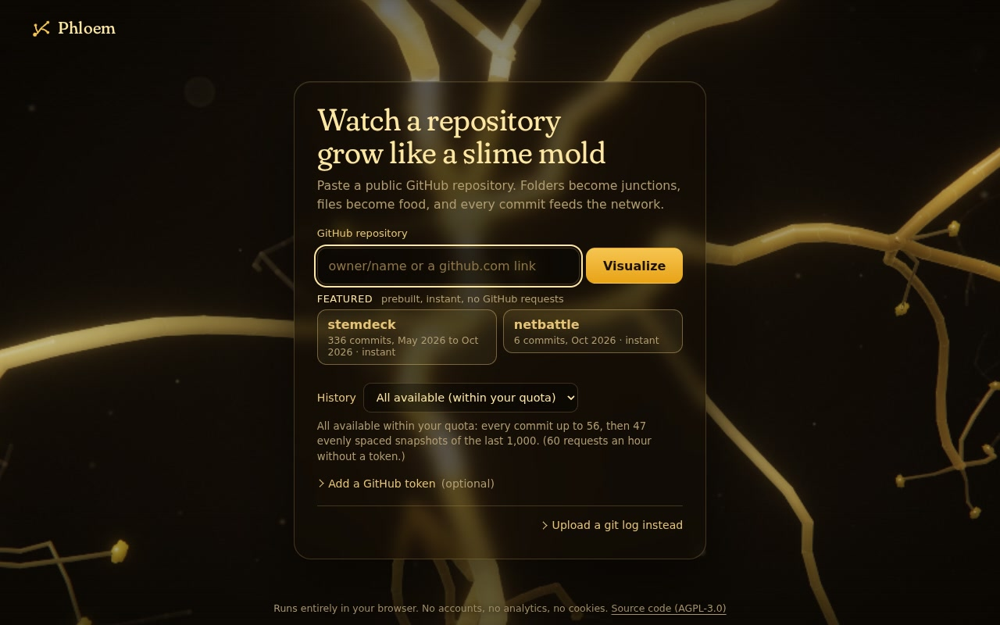
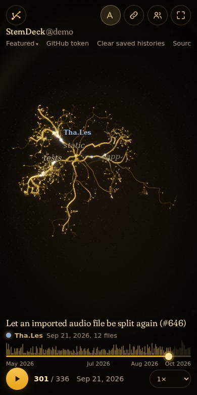

# Phloem

Watch a git history grow like a slime mold (*Physarum polycephalum*): folders are vein junctions, files are food, every commit feeds the network and busy paths thicken.
Paste a public GitHub repository (or upload a `git log` file) and the history replays in 3D in your browser. Everything runs client-side: no backend, no analytics, no cookies.

**Live: https://phloem.stemdeck.app** · Source: https://github.com/thcp/phloem · License: AGPL-3.0-only




<p>
  
  
</p>

## Run

```
npm install
npm run dev          # http://localhost:5173
npm test             # unit tests
npm run build        # type-check + production build into dist/ (also checks that no test hook ships)
npm run preview      # serve dist/
```

`?demo` (development and tests only; the landing page has no demo button) opens the bundled StemDeck history without any network access. Other developer parameters and tests: `docs/ARCHITECTURE.md`. What was tested, known gaps and a manual checklist (including how to read the frame rate on a real GPU): `docs/QA.md`.

## Controls

Left-drag pans, middle-drag orbits, right-drag rotates left and right around the vertical axis, the wheel zooms, double-click or `R` resets the camera. Touch: one finger orbits, two fingers pinch and pan, double-tap resets. A cinematic camera follows the action by itself; touch the view and it hands over to you, then eases back in after a few quiet seconds.
`Space` play/pause, `←`/`→` previous/next commit, `L` name labels (all / active / off), `F` fullscreen, `S` frame stats (also `?stats`), `H` hide the controls. Drop a `git log` file anywhere on the page to load it.

## URL parameters

`?repo=owner/name&branch=&max=all&t=120&labels=all&quality=auto&speed=1` (also `mode=`, `fps=`; `demo` is dev-only). `max` defaults to `all` (everything the GitHub quota allows). `t` is the commit number to start at. Full table: `docs/WEB.md`.

## Featured repositories

The repositories listed in `src/web/featured.config.json` open instantly from prebuilt histories (`public/featured/`, no GitHub requests). Regenerate with `npm run featured` (needs `gh` and git; public repositories only, author emails are stripped). See `docs/INGESTION.md`.

## Deploy

A static site, deployed on Vercel at https://phloem.stemdeck.app. Step-by-step (import the repository, environment variables, domain and DNS): `docs/DEPLOY.md`. `vercel.json` carries the security headers and cache rules; GitHub Actions (`.github/workflows/ci.yml`) only type-checks, tests and builds.
Environment variables and other hosts: `docs/WEB.md`.

## Tests

`npm test` runs the unit tests (vitest). The browser checks (Playwright, Python) drive an e2e build that keeps the `window.__phloem` test hook, which normal builds do not contain: `npm run build:e2e`, see `tests/e2e/README.md`.

## Privacy

Everything runs in your browser. There is no backend, no analytics, no cookies. The only network calls are GitHub API requests you start, sent straight from your browser to `api.github.com`.
A GitHub token is optional; it stays in memory unless you press "Save on this device" (then `localStorage`, removable), is sent only to `api.github.com`, and is never put in a URL.
Finished loads of public repositories are saved in your browser (IndexedDB) so reopening them is instant; "Clear saved histories" removes them. A `git log` file you upload never leaves your computer.

## License

Copyright (C) 2026 Phloem contributors. Licensed under the GNU Affero General Public License, version 3 only (`AGPL-3.0-only`); see `LICENSE`. If you run a modified version as a network service you must offer its users the corresponding source (section 13): the page links to it ("Source code (AGPL-3.0)"); a fork sets `VITE_SOURCE_URL` at build time to its own source URL (`docs/WEB.md`).

Credits: the display font, Fraunces, is © The Fraunces Project Authors and is used under the SIL Open Font License 1.1 (`src/ui/fonts/OFL.txt`, also served as `OFL-Fraunces.txt`). It is a separate work with its own license. Development dependencies are MIT, ISC, BSD-3-Clause or Apache-2.0; none is bundled into the shipped page.
The bundled StemDeck demo and the prebuilt featured histories are commit metadata (names, dates, subjects, file paths; no emails) of those public repositories.
